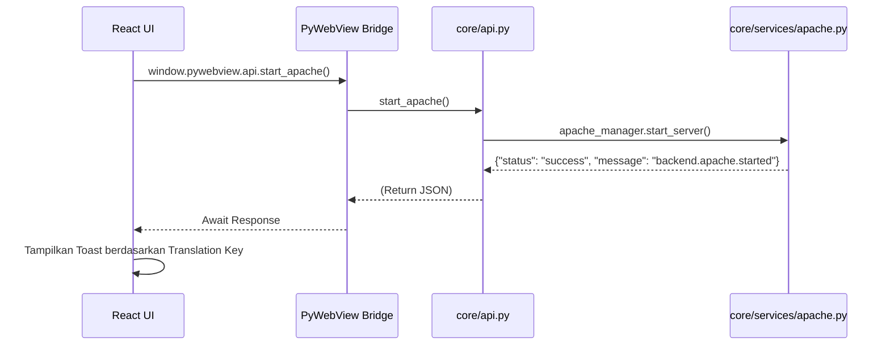
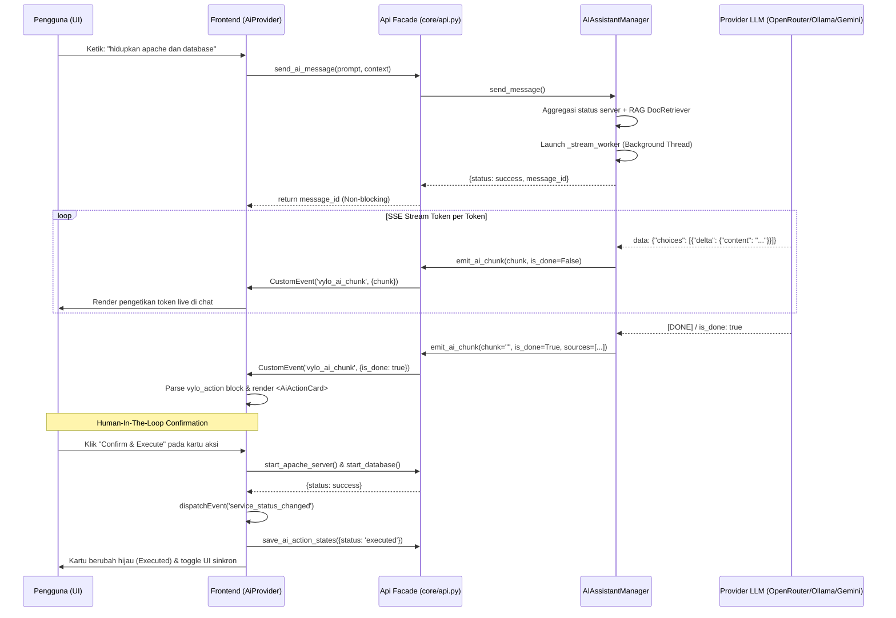
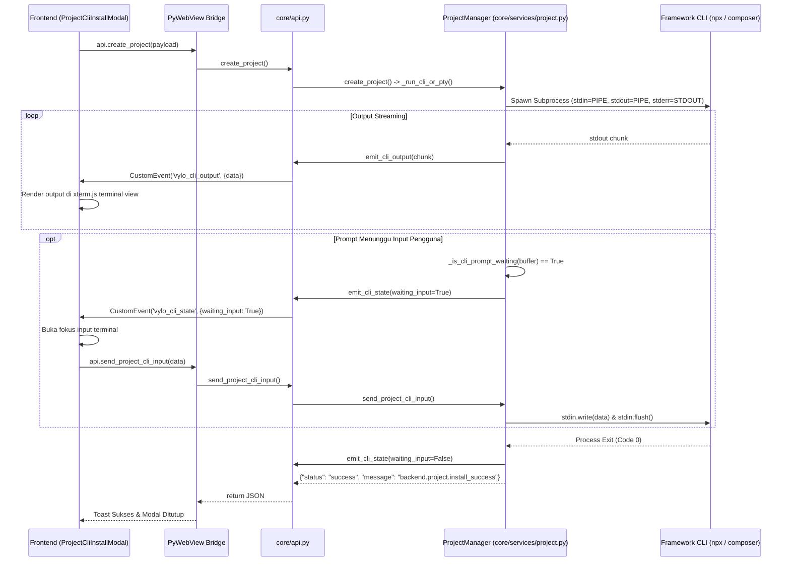

# Arsitektur & Alur Aplikasi (Flow)

VyloServe dibangun dengan arsitektur **Desktop Hybrid** di mana Backend dikendalikan oleh Python, namun antarmuka menggunakan teknologi Web modern (React). Penghubungnya adalah pustaka Python bernama `pywebview`.

## 1. Konsep Jembatan PyWebView (API Bridge)
Tidak seperti aplikasi web tradisional yang berkomunikasi lewat HTTP (REST API), VyloServe menggunakan *JavaScript Interop* melalui objek window browser.

0. **Single-Instance Check & Named Pipe IPC (sebelum apa pun lain):** `main()` di `main.py` memanggil `check_single_instance()` dengan penamaan terisolasi per mode (`VyloServe_App_Mutex_v1` di production vs `VyloServe_Dev_App_Mutex_v1` di development, terdeteksi otomatis via `sys.frozen`) **sebelum** membuat `Api()`/window apa pun. Langkah ini juga mengonfigurasi `AppUserModelID` terpisah (`VyloServe.App.Production` vs `VyloServe.App.Development`) dan judul window yang berbeda agar taskbar Windows tidak mencampuradukkan kedua mode. Kalau mutex sudah dimiliki proses lain, proses baru tidak membuat window sama sekali — melainkan mengirim sinyal `"SHOW"` melalui **Windows Named Pipe IPC** (`\\.\pipe\VyloServe_IPC_v1` atau `\\.\pipe\VyloServe_Dev_IPC_v1`) via `send_show_command_to_pipe()`, lalu segera keluar via `sys.exit(0)`. Proses utama yang sudah berjalan mendengarkan pipe melalui thread latar belakang `start_ipc_server()`, dan mengeksekusi `show_and_bring_to_front()` secara thread-safe pada WinForms UI thread (`lifecycle.window.gui.Form.Invoke(...)` atau `window.show()`), mencegah crash aplikasi saat window sedang disembunyikan di System Tray. Warna latar window awal (`background_color` di `webview.create_window()`) juga sudah ditentukan di titik ini lewat `get_theme_bg_color()`, dan warna caption/teks titlebar native Windows disinkronkan secara mulus via DWM API (`apply_window_titlebar_theme`) saat event `shown` dan `restored`.
1. **Inisialisasi Backend:** Di `main.py`, Python membuat kelas `Api` (dari `core/api.py`). Objek ini diekspos ke antarmuka saat *window* dibuat. Segera setelah `api.set_window(window)`, `main()` juga memanggil `api.start_log_watcher()` — lihat §6 di bawah.
2. **Reaksi Frontend:** Di React, objek tersebut diakses melalui `(window as any).pywebview.api`.
3. **Panggilan Fungsi:** Saat frontend memanggil fungsi `api.start_apache_server()`, perintah ini dieksekusi **secara langsung** di runtime Python (Synchronous/Asynchronous).
4. **Respon (Return):** Fungsi Python wajib mengembalikan (return) sebuah Dictionary (JSON) yang berisikan kunci `status` (`"success"` / `"error"`) dan `message` (berupa **Translation Key**).



## 2. Event Emitter (Python -> React)
Karena fungsi backend yang panjang (seperti *download* engine) bisa memblokir antarmuka, backend **dilarang** mengembalikan progress bar lewat *return*. Backend harus *menembakkan* event (emit) secara real-time.

Di `core/api.py`, fungsi `emit_log` dan `emit_progress` diatur untuk mengeksekusi *CustomEvent* JavaScript di window React.

```python
# Di dalam Python (Backend) — core/api.py, disederhanakan (detail lengkap di docs/backend_services.md §2.2)
def emit_progress(self, percent: int, text: str = "", args: dict = None):
    source = self._resolve_event_source()  # auto-deteksi Manager pemanggil via inspect
    detail = json.dumps({"percent": percent, "text": text, "args": args or {}, "source": source})
    self.window.evaluate_js(f"window.dispatchEvent(new CustomEvent('vylo_progress', {{detail: {detail} }}));")
```

Di frontend (React), komponen `<BackgroundProgressWidget>` akan mendengarkan event tersebut dan merender Progress Bar mengambang (overlay) secara real-time.

> ⚠️ **Kontrak `percent` yang wajib dipatuhi:** nilainya selalu **absolut 0-100** (bukan fraksi), dan frontend memperlakukan **`percent >= 100` atau `percent <= 0` sebagai sinyal "proses selesai total"** — memicu auto-hide widget progress setelah jeda singkat. Backend **tidak boleh** mengirim `emit_progress(100, ...)` untuk checkpoint di tengah alur multi-tahap (hanya untuk tahap paling akhir). Dua bug produksi nyata pernah terjadi karena kontrak ini dilanggar/disalahtafsirkan — lihat `docs/known_bugs.md` #16 dan #18, serta `docs/frontend_ui.md` §3.4 untuk detail sisi frontend.

## 3. Sistem i18n *Frontend-Driven*
Untuk mendukung multibahasa, aplikasi menerapkan prinsip **Frontend-Driven i18n**. 
Aturan Emas: **Backend Python DILARANG keras mengembalikan pesan hardcode.**

Backend harus mereturn sebuah kunci terjemahan (*translation key*), yang kemudian akan diterjemahkan oleh React (menggunakan library `react-i18next`).
```python
# BENAR:
return {"status": "success", "message": "backend.project.install_success"}
# SALAH:
return {"status": "success", "message": "Aplikasi berhasil dijalankan"}
```

## 4. Alur Keluar (Graceful Exit)
Aplikasi memiliki *System Tray* (ikon di pojok kanan bawah Windows).
- Jika pengguna menekan tanda silang (X) pada Window **dan tray aktif** (`ENABLE_TRAY`/`enable_tray`, sejak fitur histori toast — lihat `docs/known_bugs.md` #45, saat ini aktif di dev mode MAUPUN production, bukan lagi production-only), aplikasi **TIDAK AKAN** tertutup. Melainkan hanya sembunyi (Hide) ke *System Tray*, membiarkan proses Apache/PHP/Database tetap berjalan di latar belakang. Kalau tray tidak aktif (`enable_tray=False`), window langsung tertutup penuh seperti biasa — **BUKAN lagi dikontrol `IS_PRODUCTION`** seperti versi sebelumnya; detail lengkap pemisahan kedua flag ini ada di `docs/backend_services.md` §14.1/§14.2.
- Aplikasi hanya benar-benar mati jika fungsi `api.close_app()` dipanggil (lewat menu "Quit" di tray atau UI).
- Saat `close_app()` dipanggil, `perform_exit()` di `main.py` memanggil `apache.stop_server()`, `php.stop_all()`, dan `database.stop_all()` (masing-masing dibungkus try/except sendiri) sebelum System Tray & window dihentikan dan `os._exit(0)` dipanggil — mencegah proses child (`httpd.exe`, `php-cgi.exe`, `mysqld.exe`/`postgres.exe`) tertinggal sebagai *zombie process*. ✅ *Catatan audit:* sempat ditemukan versi kode di mana pemanggilan cleanup ini hilang (lihat riwayat di `docs/known_bugs.md` #6) — sudah dikonfirmasi diperbaiki.
- Setiap kali window di-minimize/di-restore/disembunyikan-ke-tray, state-nya di-push ke frontend lewat `Api.emit_window_state()` (`evaluate_js` + `CustomEvent('vylo_window_state', ...)`) — dipakai untuk menentukan kapan toast perlu diteruskan sebagai notifikasi native Windows (`win11toast`). Detail lengkap: `docs/backend_services.md` §14.4, `docs/frontend_ui.md` §5.1.

## 5. Pola Async Gabungan: Request-Response + Event Streaming
Alur seperti instalasi Apache/PHP/Database/Runtimes **bukan** sekadar satu `await` sederhana seperti pada diagram di §1. Polanya adalah kombinasi dua mekanisme yang berjalan paralel:
1. Frontend memanggil `api.install_x(...)` dan menunggu (`await`) **satu** response akhir (`{status, message}`).
2. **Selama** proses itu berjalan di backend, event `vylo_progress` dan `vylo_log` ditembakkan berkali-kali secara independen ke `window` — komponen frontend (halaman modul + `LogsPanel`) mendengarkan event ini secara terpisah dari `await` di atas, sehingga progress bar/log ter-update *real-time* walau response akhir baru diterima setelah proses selesai total.

Lihat `docs/frontend_ui.md` §6 untuk sequence diagram lengkap alur ini, termasuk pola "minimize modal" (`BackgroundProgressWidget`) dan potensi *event leak* lintas modul (`docs/known_bugs.md` #7).

## 6. Pola Async Ketiga: Background Push Berkelanjutan (Log Watcher)

Berbeda dari §5 (event yang hanya mengalir **selama** satu aksi user tertentu berjalan, mis. instalasi), ada satu mekanisme yang **tidak pernah berhenti dan tidak dipicu aksi user apa pun**: *log watcher*.

- `Api.start_log_watcher(interval=2.0)` (dipanggil sekali saat bootstrap, §1 poin 1) menjalankan **satu thread daemon** yang berjalan sepanjang hidup aplikasi — pola yang sama seperti thread System Tray di §4, bukan `asyncio`/event loop.
- Tiap `interval` detik (default 2 detik), thread ini memanggil `ApacheManager.tail_new_logs()` dan `DatabaseManager.tail_new_logs()`, yang membaca baris **baru** (sejak polling terakhir) di `logs/error_log`/`logs/access_log` Apache dan `db_startup.log`/`*.err` Database — **hanya** untuk servis yang sedang berjalan.
- Setiap baris baru diteruskan lewat `emit_log(line, level, {}, source_override='ApacheFileLog'|'DatabaseFileLog')` — parameter `source_override` memaksa kategori tertentu, mem-bypass auto-detection nama class pemanggil (`_resolve_event_source()`, §2), supaya baris file log bisa difilter terpisah dari pesan sistem biasa di panel Log (lihat `docs/known_bugs.md` #26).
- `Api.stop_log_watcher()` menghentikannya dengan bersih saat `AppLifecycle.perform_exit()` (§4).

Detail lengkap mekanisme tail-file (offset tracking, retry saat file terkunci Windows, dsb.): `docs/backend_services.md` §11.2. Detail sisi frontend (filter level/kategori, UI toggle): `docs/frontend_ui.md` §12.

## 7. Pola Async Keempat: AI Streaming (SSE) & Eksekusi Proposal Aksi Terstruktur (HITL)

Fitur AI Assistant (Server Copilot) mengombinasikan streaming respons real-time dengan kendali layanan Human-In-The-Loop (HITL) yang aman:



### 7.1 Keunggulan Alur Ini
1. **Responsif Tanpa Blokir UI:** Permintaan awal langsung selesai dalam milidetik, sementara pembacaan token SSE berjalan independen di background thread Python.
2. **Keamanan Eksekusi (Zero Unintended Action):** Model AI **tidak** memiliki izin eksekusi langsung ke sistem operasi. AI hanya merespons dalam bentuk kartu proposal aksi. Eksekusi OS hanya terjadi jika dan hanya jika pengguna secara sadar menekan tombol konfirmasi.
3. **Sinkronisasi Multi-Screen:** Begitu aksi dikonfirmasi di jendela AI, event browser `service_status_changed` ditembakkan sehingga kartu modul Apache/PHP/Database dan toggle di Sidebar langsung berubah menjadi "Running" secara serentak.
4. **Dual-Layer Persistence:** Status kartu aksi disimpan ganda ke state React dan disk (`data/ai_action_states.json` & `data/ai_chat_history.json`). Sesi chat yang dibuka ulang tetap mengingat bahwa aksi telah selesai dijalankan.

## 8. Arsitektur Frontend Modular (Domain Contexts & Component Hygiene)

Untuk mematuhi prinsip Clean Code, Single Responsibility Principle (SRP), dan batas *Cognitive Complexity* SonarQube ($\le 15$), frontend VyloServe menerapkan standardisasi modular:

### 8.1 Pemisahan Domain Context (`frontend/src/context/`)
Komunikasi dan state dalam lingkup modul didelegasikan ke React Context terdedikasi, memisahkan logika bisnis (fetch status, validasi input, handler submit) dari hierarki rendering:
- **`ProjectContext.tsx`**: State proyek web, scaffolding multi-runtime (PHP, Node, Python, Go, Java), dev server lifecycle & live logs, pembuatan Virtual Host, dan sinkronisasi Windows hosts.
- **`ApacheContext.tsx`**: State lifecycle Apache, status port, switch versi Apache, konfigurasi proxy.
- **`PhpContext.tsx`**: State multi-versi PHP, port configuration, php.ini parser, modul ekstensi.
- **`DatabaseContext.tsx`**: Instance MySQL/PostgreSQL, validasi port ganda, reset password root.
- **`DashboardContext.tsx`**: Agregasi global service toggles, resource load (CPU/RAM), suggestions.
- **`RuntimesContext.tsx`**: Status 4 runtime engine (Node, Python, Java, Go), orkestrasi `RuntimePathHub`, registrasi PATH Windows, switch versi aktif.
- **`TunnelsContext.tsx`**: Tunneling zrok & Cloudflare, session token, port proxying, searchable project selector.
- **`GitContext.tsx`**: PortableGit install, konfigurasi global git, deteksi native OS alert, & user path synchronization.
- **`AiContext.tsx`**: Chat stream, model discovery, attachment context, action card states.

### 8.2 Component Hygiene & Extraction
- **Pembersihan Folder `components/`**: Komponen yang ada di `frontend/src/components/` dijamin bersifat 100% generik (`Modal`, `Card`, `Button`, `PageHeader`, `Select`, `StatusBadge`, `ProgressStatusBlock`, `DataTable`, `FilterChips`, `ViewModeToggle`, `InstalledBadge`, `ServiceToggleButton`). Komponen yang terikat spesifik ke modul tertentu (misalnya `AiActionCard`, `AiChatMessage`, `AiFloatingWidget`, `RuntimePathHub`, `ProjectsTable`) diletakkan di direktori modul masing-masing (`menu/tools/ai-assistant/components/`, `menu/runtimes/`, `menu/projects/`).
- **Orchestration Views**: File `Main.tsx` di tiap modul tidak lagi menjadi "God Component" monolitik ribuan baris, melainkan file orkestrator ramping (berisi `<PageHeader>`, status kartu, dan delegasi sub-komponen modal/tabel).
- **Sub-komponen Dialog**: Dialog modal diekstrak ke file terpisah (`NewProjectModal.tsx`, `ProjectSettingsModal.tsx`, `ProjectCliInstallModal.tsx`, `PhpSettingsModal.tsx`, `DatabaseSettingsModal.tsx`, `InstallGitModal.tsx`, `TunnelsInstallModal.tsx`, `TerminalSettingsModal.tsx`) sehingga mempermudah pengujian terisolasi dan pemeliharaan jangka panjang.

## 9. Pola Async Kelima: Interactive CLI / PTY Subprocess Streaming (`ProjectManager`)

Saat membuat proyek baru berbasis framework modern (seperti `create-next-app`, `create-vite`, atau Laravel Composer), CLI sering kali meminta masukan interaktif dari pengguna (misal: pilihan TypeScript, ESLint, Tailwind CSS, App Router). Jika dieksekusi lewat `subprocess.run()` biasa, proses akan terblokir selamanya (*hang*) di latar belakang.

VyloServe menerapkan jembatan PTY/Subprocess dua arah:



## 10. Pola Async Keenam: Integrated Developer Terminal Subprocess/PTY Bridge (`TerminalManager`)

Developer Terminal terintegrasi (`core/services/terminal.py`) mengoperasikan sesi shell interaktif persisten multi-tab berbasis `xterm.js`:
1. **Pembuatan Sesi & Environment Scoping:** `create_session(shell_id, cwd, runtime_scope)` membangun variabel lingkungan terisolasi via `_build_session_env()`. Direktori `bin` runtime yang dipilih (mis. Node.js v20 dan Go 1.22) disuntikkan ke variabel `PATH` lokal sesi tersebut, memprioritaskannya di atas PATH sistem tanpa mengubah Windows Registry global.
2. **Pembacaan Output Asinkron:** Setiap sesi terminal menjalankan thread latar belakang `_reader_thread_func()` yang membaca `stdout` proses secara terus-menerus dan menembakkannya via `api.emit_terminal_output(session_id, data)`.
3. **Pelacakan CWD Real-Time:** Frontend secara berkala memanggil `api.get_terminal_session_cwd(session_id)` untuk mendeteksi direktori kerja terkini dari proses anak (menggunakan `GetModuleFileName` / parsing prompt) agar tab dapat menampilkan nama direktori aktif secara dinamis.
4. **Pembersihan Bersih (Clean Teardown):** Saat tab ditutup atau aplikasi keluar, `close_session(session_id)` mengirim sinyal terminasi ke process tree anak dan menutup file descriptor untuk mencegah kebocoran proses OS.

## 11. Alur Manajemen Dev Server Proyek

Untuk framework non-PHP (seperti Next.js, FastAPI, Vite, Gin, atau Spring Boot), VyloServe menyediakan kontrol siklus hidup Dev Server terintegrasi:
- **`start_project_server(project_id)`**: Membaca file starter yang di-generate (mis. `start-dev.bat`), meluncurkan server pengembangan di port reverse proxy teralokasi (mis. `127.0.0.1:3000`), dan memetakan output log ke `data/logs/projects/<project_id>.log`.
- **`stop_project_server(project_id)`**: Mematikan pohon proses server pengembangan (`taskkill /F /T /PID`) dan memperbarui status vhost.
- **Reverse Proxy Virtual Host:** Konfigurasi Apache `<VirtualHost>` mengarahkan domain `.local` langsung ke port internal dev server menggunakan `ProxyPass` dan `ProxyPassReverse`, lengkap dengan tunneling WebSocket (`ws://` / `wss://`) untuk mendukung fitur *Hot Module Replacement* (HMR) bawaan framework modern.

## 12. Orkestrasi Multi-Versi Runtimes & Centralized `RuntimePathHub`

Modul Runtimes menerapkan pemisahan dua tingkat (*Two-Tier UX Pattern*):
1. **Level 1 (Global System Orchestration — `RuntimePathHub`):**
   - Mengendalikan variabel `HKCU\Environment\Path` tingkat sistem operasi melalui toggle tunggal.
   - Mengatur versi mana yang dipromosikan sebagai versi aktif di CMD/PowerShell global melalui dropdown pemilih versi.
   - Menampilkan kotak alert kontekstual in-card (`data-testid="path-hub-external-alert"`) bila biner native OS terdeteksi, mengunci toggle registrasi PATH untuk mencegah benturan prioritas binary (*path shadowing*).
2. **Level 2 (Local Binary Inventory — 100% Symmetric Cards):**
   - Menampilkan daftar versi portable yang terpasang di `bin/runtimes/<engine>/<version>`.
   - Seluruh kartu versi memiliki struktur visual simetris yang bersih, hanya menyajikan informasi biner dan tombol aksi primer (*Open Folder*, *Open in Terminal*).
   - Aksi mutasi (*Set as Active*, *Deactivate*, *Update*, *Uninstall*) diakses secara rapi melalui menu `...` di pojok kanan atas kartu, menciptakan konsistensi antarmuka yang setara di Card View maupun Table View.

