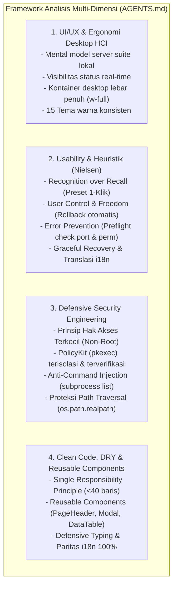

# Backlog & Panduan Implementasi Enhancement Khusus Linux (Linux Enhancements Backlog)

Dokumen ini disusun sebagai panduan teknis dan daftar backlog fitur resmi (*Authoritative Implementation Backlog*) bagi pengembang yang mengerjakan cabang porting Linux (`linux-application-porting`). Dokumen ini menganalisis titik-titik friksi (*pain points*) pengembang web & server di lingkungan Linux yang selama ini masih sering dieksekusi manual via terminal (CLI), serta merumuskan arsitektur solusinya sesuai dengan standar **Framework Analisis Multi-Dimensi `AGENTS.md`** (HCI/IMK, Heuristik Usabilitas, Defensive Security, dan Clean Code & DRY).

---

## 1. Latar Belakang & Filosofi Porting ke Linux

Porting VyloServe ke lingkungan Linux bukan sekadar "membuat kode Windows berjalan di Linux dengan banyak `if sys.platform == 'win32'`". Porting ini bertujuan untuk menghadirkan pengalaman pengembang yang mulus (*zero-friction development*) dengan memanfaatkan keunggulan POSIX kernel Linux dan menyelesaikan masalah-masalah klasik yang selalu dihadapi developer Linux:

| Masalah Klasik Developer di Linux | Pendekatan Tradisional (CLI Manual) | Solusi Arsitektural VyloServe di Linux |
| :--- | :--- | :--- |
| **Bentrok Permission & File Ownership** | `chmod -R 777`, `chown -R $USER:www-data`, atau error permission denied saat upload file. | **User-Mapped Execution:** Server & worker berjalan dengan UID/GID developer aktif (`os.getuid()`), plus fitur **Permission Doctor 1-Klik** per framework. |
| **Port Privileged (< 1024) untuk HTTP/HTTPS** | Menjalankan aplikasi dengan `sudo` (berbahaya) atau terpaksa pakai port tinggi `8080`/`8443`. | **Linux Capabilities (`cap_net_bind_service`):** Elevasi PolicyKit granular satu kali via `pkexec` agar binary Apache dapat mengikat port 80/443 tanpa hak root. |
| **Bentrok Port dengan Service Host OS** | `sudo systemctl stop apache2/mysql` secara manual setiap kali service gagal start. | **Systemd Conflict Detector:** Deteksi otomatis unit systemd yang sedang berjalan pada port target dengan opsi 1-klik untuk menghentikan sementara. |
| **Pendaftaran Virtual Host `.test`** | Mengetik `sudo nano /etc/hosts` setiap kali menambah proyek baru. | **Local Wildcard DNS Resolver:** Integrasi `systemd-resolved` / loopback resolver untuk `*.test -> 127.0.0.1` tanpa pernah menyunting `/etc/hosts`. |
| **Fragmentasi Kepercayaan SSL Root CA** | Mengimpor manual via CLI ke `/etc/ssl/certs`, lalu error di browser karena NSS DB Chrome dan Firefox terpisah. | **Universal Linux SSL Trust:** Menginjeksi Root CA ke System Store, Chromium NSS DB (`~/.pki/nssdb`), dan profil Firefox (`cert9.db`) sekaligus. |
| **Daemon & Queue Worker Gantung** | Membuka tab terminal terpisah untuk `php artisan queue:work` yang mati saat terminal ditutup. | **Project Worker Supervisor:** Pengelolaan background worker persistent dengan auto-restart, status badge, dan live log streaming. |
| **Penjadwalan Tugas Berkala** | Mengonfigurasi `crontab -e` secara manual untuk Laravel scheduler atau database backup. | **Visual Cron & Task Scheduler:** Penjadwal tugas in-app dengan preset otomatis 1-klik dan log riwayat eksekusi. |

---

## 2. Framework Analisis Multi-Dimensi (`AGENTS.md` Rule 35)

Setiap enhancement pada backlog ini wajib mematuhi 4 pilar arsitektur:



---

## 3. Daftar Backlog Fitur Terperinci per Tier

### 🌟 TIER 1: Core Essentials & Zero-Friction Linux (Prioritas Utama)

Fitur pada Tier 1 difokuskan untuk menyelesaikan hambatan utama sistem operasi Linux yang menghalangi kenyamanan pengembangan lokal.

#### 3.1 Linux Permission & Ownership Doctor (Solusi Masalah `chmod`/`chown`)
* **Latar Belakang:** 
  Pada web framework (Laravel, Symfony, WordPress), web server menulis cache view, log, dan file upload. Jika web server berjalan dengan user terpisah (`www-data`), developer tidak dapat mengedit file tersebut di VS Code. Sebaliknya, jika developer membuat folder baru, web server melempar `500 Permission Denied`.
* **Arsitektur Solusi:**
  1. **User-Mapped Execution:** Di Linux, binary Apache dan PHP FastCGI dijalankan menggunakan identitas proses pengguna aktif:
     ```python
     # core/services/apache.py & php.py
     uid = os.getuid()
     gid = os.getgid()
     # Menjalankan proses anak dengan user yang sama dengan developer
     ```
  2. **In-App Permission Doctor:**
     - Tombol **Permission Doctor** pada menu opsi kartu proyek di Projects Hub.
     - Menyediakan modal diagnosis (`PermissionDoctorModal.tsx`) yang memindai folder proyek dan menawarkan perbaikan 1-klik:
       - **Laravel / Symfony Preset:** Direktori `storage/` dan `bootstrap/cache/` disetel `775`, file disetel `664`, dan grup diselaraskan.
       - **WordPress Preset:** Direktori `wp-content/uploads/` disetel `755` dan file disetel `644`.
       - **Standard POSIX Preset:** Normalisasi menyeluruh: direktori `755`, file `644`, owner `$USER`.
     - Menggunakan pemanggilan non-blocking di Python via `os.chmod` dan `os.chown` tanpa memerlukan `sudo` karena file berada di direktori home user.

#### 3.2 Privileged Port Helper (`cap_net_bind_service`) & Systemd Conflict Resolver
* **Latar Belakang:** 
  Proses non-root di Linux dilarang mengikat port `< 1024` (port 80 dan 443). Selain itu, distro Linux sering kali memiliki `apache2.service` atau `nginx.service` bawaan yang otomatis berjalan di port 80.
* **Arsitektur Solusi:**
  1. **Linux Capability Granular Elevation:**
     - Alih-alih menjalankan VyloServe sebagai `root`, aplikasi menggunakan PolicyKit GUI (`pkexec`) satu kali untuk menyetel kapabilitas Linux:
       ```bash
       pkexec setcap 'cap_net_bind_service=+ep' /path/to/vyloserve/bin/apache/bin/httpd
       ```
     - Ini memungkinkan binary Apache VyloServe mengikat port 80 dan 443 dengan hak akses user biasa yang aman (*Principle of Least Privilege*).
  2. **Systemd Service Conflict Detector:**
     - Saat preflight check port 80/3306/5432/6379 mendeteksi port terpakai, sistem memeriksa apakah port tersebut dikuasai oleh unit systemd:
       ```python
       # core/utils/linux_system_utils.py
       def get_systemd_conflict(port: int) -> Optional[str]:
           # Memeriksa unit aktif seperti apache2.service, nginx.service, mysql.service
       ```
     - UI menampilkan dialog informatif: *"Port 80 sedang digunakan oleh service host (`apache2.service`)"* dengan dua opsi aksi:
       - `[Stop Host Service]` -> mengeksekusi `pkexec systemctl stop apache2`
       - `[Use Alternate Port]` -> memindahkan port Apache VyloServe ke `8080`.

#### 3.3 Local Wildcard DNS Resolver (`*.test` Tanpa Sunting `/etc/hosts`)
* **Latar Belakang:** 
  Setiap membuat virtual host baru (misal `toko.test`, `api.test`), developer harus menyunting `/etc/hosts` dan memasukkan password `sudo`.
* **Arsitektur Solusi:**
  1. **Integrasi Wildcard `systemd-resolved`:**
     - Menempatkan konfigurasi drop-in di `/etc/systemd/resolved.conf.d/vyloserve.conf`:
       ```ini
       [Resolve]
       DNS=127.0.0.1:53535
       Domains=~test
       ```
     - VyloServe menjalankan listener DNS lokal ringan di port 53535 yang secara instan mengarahkan semua query domain berakhiran `.test` ke `127.0.0.1`.
     - Hasil: Developer dapat membuat puluhan virtual host baru tanpa pernah menyunting `/etc/hosts` lagi!
  2. **Fallback Manual via Polkit:** Jika sistem tidak menggunakan `systemd-resolved`, fallback menggunakan pembaruan atomik `/etc/hosts` via `pkexec`.

#### 3.4 Universal Linux SSL CA Trust Store Injector (System + NSS Chrome + Firefox)
* **Latar Belakang:** 
  Pada Linux, browser Chromium dan Firefox menggunakan database sertifikat mandiri yang terpisah dari trust store sistem operasi (`/etc/ssl/certs`), sehingga browser tetap menampilkan tanda silang merah jika hanya mengandalkan `update-ca-certificates`.
* **Arsitektur Solusi:**
  - Fitur **Generate & Install Root CA** di Linux secara simultan menginjeksi sertifikat ke 3 target:
    1. **System Trust Store:** Mendeteksi distro (`/usr/local/share/ca-certificates/` di Debian/Ubuntu, `/etc/pki/ca-trust/source/anchors/` di Fedora/RHEL, `/etc/ca-certificates/trust-source/anchors/` di Arch) dan menjalankan utilitas pembaruan trust sistem.
    2. **Chromium / Google Chrome / Edge NSS DB:** Memperbarui database NSS pengguna di `~/.pki/nssdb` menggunakan perintah:
       ```bash
       certutil -d sql:$HOME/.pki/nssdb -A -t "C,," -n "VyloServe Root CA" -i /path/to/rootca.crt
       ```
    3. **Mozilla Firefox Profiles:** Memindai seluruh direktori profil di `~/.mozilla/firefox/*.default*/` dan mengimpor Root CA ke database `cert9.db`.
  - Hasil: Domain `https://proyek.test` langsung berstatus gembok hijau aman di seluruh browser Linux tanpa konfigurasi manual.

---

### 🚀 TIER 2: Produktivitas & Automasi Developer (Prioritas Menengah)

#### 3.5 Project Daemon & Queue Worker Supervisor
* **Latar Belakang:** 
  Developer sering kali harus membuka jendela terminal terpisah hanya untuk menjalankan queue worker (seperti `php artisan queue:work`, `celery`, `python worker.py`) atau build watcher (`npm run watch`), yang otomatis mati jika terminal tertutup.
* **Arsitektur Solusi:**
  - Tab **Background Workers** di dalam menu Projects Hub.
  - Pengembang dapat mendefinisikan worker yang diikat ke proyek:
    - Perintah otomatis (misal: `php artisan queue:work --sleep=3 --tries=3`).
    - Status lifecycle mandiri (Running, Idle, Crashed, Auto-restarting).
    - Auto-restart jika script crash atau saat server proyek dinyalakan.
    - Modal streaming log proses secara *real-time*.

#### 3.6 Visual Cron & Task Scheduler
* **Latar Belakang:** 
  Konfigurasi jadwal berkala (seperti Laravel Scheduler `* * * * * php artisan schedule:run`) memaksa developer menyunting `crontab -e` secara manual.
* **Arsitektur Solusi:**
  - Antarmuka visual penjadwalan tugas terintegrasi di menu Tools.
  - Preset 1-klik untuk:
    - *Laravel Scheduler Runner* (dijalankan setiap 60 detik).
    - *WordPress Cron Trigger* (`wp-cron.php`).
    - *Automated Database Dump / Backup*.
  - Riwayat eksekusi, durasi tugas, dan status kode keluar (*exit code*).

#### 3.7 Native Linux POSIX Terminal Hub (Bash, Zsh, Fish & POSIX PTY)
* **Latar Belakang:** 
  Terminal bawaan di Windows menggunakan `pywinpty` dan ConPTY. Di Linux, arsitektur terminal harus menggunakan subsistem POSIX PTY native.
* **Arsitektur Solusi:**
  - Implementasi backend PTY menggunakan pustaka standar Python `pty` / `ptyprocess`.
  - Deteksi otomatis shell Linux yang terpasang dari `/etc/shells` (`/bin/bash`, `/usr/bin/zsh`, `/usr/bin/fish`).
  - Dukungan penuh *Environment Scoping*: menyuntikkan toolchain biner VyloServe portabel ke variabel lingkungan `PATH` sesi terminal tersebut.

---

### 🎨 TIER 3: Integrasi Desktop Linux & Pengalaman Pengguna (Polish & HCI)

#### 3.8 Integrasi FreeDesktop XDG, Tray (SNI) & Polkit Policy
* **Desktop Launcher (`.desktop`):** Pemasangan otomatis launcher `~/.local/share/applications/vyloserve.desktop` dengan ikon SVG resmi dan kategori `Development;IDE;Server;`.
* **System Tray Modern (StatusNotifierItem / AppIndicator):** Mendukung tray icon pada GNOME (via extension), KDE Plasma, dan XFCE.
* **PolicyKit Actions (`org.vyloserve.policy`):** Menyediakan definisi aksi Polkit resmi di `/usr/share/polkit-1/actions/org.vyloserve.policy` sehingga popup otentikasi menampilkan nama dan logo resmi VyloServe saat meminta hak akses khusus.
* **Desktop Notification (FreeDesktop D-Bus):** Mengirim notifikasi native Linux via D-Bus `org.freedesktop.Notifications` menggantikan pustaka Windows `win11toast`.

#### 3.9 Per-Service Memory & CPU Inspector (via Linux `/proc`)
* Di Linux, membaca metrik proses sangat efisien tanpa overhead melalui sistem berkas `/proc/<pid>/statm` dan `/proc/<pid>/status`.
* Menampilkan pemakaian memori riil (RSS) dan beban CPU pada masing-masing kartu layanan (Apache, PHP FastCGI instances, MariaDB, PostgreSQL, Redis) secara transparan.

---

## 4. Struktur Modul & Rencana Berkas (Proposed Code Architecture)

Berikut adalah rancangan pemisahan berkas backend dan frontend yang perlu disiapkan oleh pengembang porting:

```text
vyloserve/
├── core/
│   ├── services/
│   │   ├── permission_doctor.py      # [NEW] Diagnosa permission & auto-fix chmod/chown/setfacl
│   │   ├── wildcard_dns.py           # [NEW] Integrasi systemd-resolved & loopback DNS resolver
│   │   ├── worker_supervisor.py      # [NEW] Daemon supervisor queue workers & background tasks
│   │   ├── task_scheduler.py         # [NEW] Visual cron scheduler runner terisolasi
│   │   ├── ssl_manager.py            # [MODIFY] Tambah backend Linux NSS DB & system ca-certificates
│   │   ├── terminal.py               # [MODIFY] Gunakan ptyprocess POSIX di Linux
│   │   └── project.py                # [MODIFY] Integrasi permission doctor & worker supervisor
│   └── utils/
│       ├── linux_system_utils.py     # [NEW] Helper Linux: Polkit pkexec, setcap, systemd detector, /proc reader
│       └── system_utils.py           # [MODIFY] Abstraksi cross-platform (delegasi win32 vs linux)
└── frontend/
    └── src/
        ├── menu/
        │   ├── projects/
        │   │   ├── PermissionDoctorModal.tsx  # [NEW] Modal diagnosis & fix permission 1-klik
        │   │   └── ProjectWorkersTab.tsx      # [NEW] Kontrol background daemons / queue workers
        │   └── tools/
        │       └── scheduler/                 # [NEW] Antarmuka Visual Cron / Task Scheduler
        └── locales/
            ├── en/translation.json            # [MODIFY] Penambahan translation keys backend.* dan ui.*
            └── id/translation.json            # [MODIFY] Paritas 100% terjemahan Bahasa Indonesia
```

---

## 5. Rencana Verifikasi & Standar Pengujian (Verification Guidelines)

Sesuai aturan `AGENTS.md` Rule 15–23 dan Rule 36:
1. **Mocking Operasi Sistem Linux:**
   - Semua eksekusi `pkexec`, `systemctl`, `setcap`, `chmod`, `chown`, dan `setfacl` wajib di-mock dalam unit test Pytest.
   - Dilarang keras menyentuh atau menghapus file sistem fisik atau file konfigurasi pengembang (`data/*.json`, `bin/`).
2. **Suite Test Baru yang Wajib Disiapkan:**
   - `tests/test_services/test_permission_doctor.py`: Happy path, Laravel/WordPress presets, dan error paths.
   - `tests/test_services/test_linux_system_utils.py`: Unit systemd parser, `/proc` memory parser, dan argumen `pkexec`.
   - `frontend/tests/menu/projects/PermissionDoctorModal.test.tsx`: Pengujian visual state, tombol aksi, dan transisi modal.
3. **Validasi Kualitas Kode:**
   - SonarQube Zero-Tolerance: 0 Bugs, 0 Vulnerabilities, 0 Security Hotspots, dan 0 Code Smells.
   - Verifikasi paritas i18n: `python -m pytest tests/test_i18n_keys.py` dan `npm --prefix frontend test -- tests/i18n.test.ts`.
   - Verifikasi kompilasi build frontend: `npm --prefix frontend run build` (`tsc -b && vite build`).
